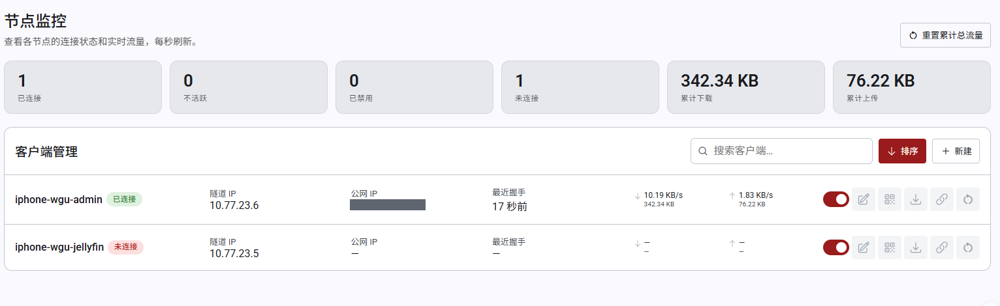

# wg-ui-plus-lan

面向家庭内网远程访问的 WireGuard 管理面板。给自己的设备开放家庭内网，给家人或朋友只开放指定服务。扫码前即可看到手机将走哪些 VPN 路由，以及用哪个 DNS。

本项目是基于 Vijay Gill 的 [wg-ui-plus v2.0.11](https://github.com/vijaygill/wg-ui-plus/tree/v2.0.11) 进行的非官方二次开发。项目沿用上游的节点、分组和访问目标模型，在此基础上完善了中文管理界面、内网分流和日常运维操作。

## 节点监控界面



## 这个版本增加了什么

- **中文节点面板**。在一页查看隧道地址、最近握手、实时上下行和累计流量。顶部总量和单个节点可分别重置。
- **可配置的客户端 DNS 和路由**。内网节点默认沿用设备的 DNS。可以按节点选择使用 VPN DNS，以及是否加入到 VPN 服务端隧道地址的路由。
- **扫码前预览**。二维码旁显示实际下发的连接端点、节点地址、路由和 DNS。
- **撤销待应用更改**。把待应用的 WireGuard 配置恢复到上次成功应用的状态，撤销操作无需重启隧道。

## 快速开始

在已安装 Git、Docker Engine 和 Docker Compose 插件的 Linux 主机上拉取项目。

```bash
git clone https://github.com/wenguge/wg-ui-plus-lan.git
cd wg-ui-plus-lan
cp .env.example .env
```

在 `.env` 填写自己的公网端点、内网网段和 Django 密钥，然后启动。

```bash
docker compose up -d --build
```

管理面板默认绑定服务器回环地址。首次登录、SSH 转发和内网权限分组的步骤见 [中文部署说明](docs/compose.zh-CN.md)。如果把面板部署在云 VPS 上，还需要为 VPS 配好到家庭内网的可达路由。

## 上游与许可证

感谢 Vijay Gill 和 [wg-ui-plus](https://github.com/vijaygill/wg-ui-plus) 的贡献者。本仓库保留上游 Git 历史、原作者版权声明和 [MIT 许可证](LICENSE)。
